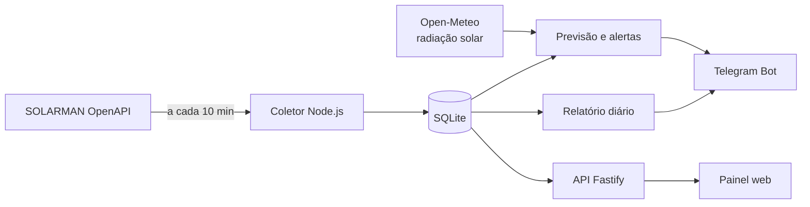

#solar-monitor

Monitor pessoal de energia solar. Coleta os dados da **SOLARMAN OpenAPI**, guarda o histórico em **SQLite** e manda pelo **Telegram** um relatório diário, a previsão de geração do dia seguinte e alertas quando algo para ou rende abaixo do esperado. Tem também um painel web leve para acompanhar pelo celular.

## Por que existe

O app do fabricante mostra os números, mas não responde à pergunta que eu mais fazia: *"está tudo certo com as minhas placas?"*. Este projeto responde isso sozinho: resume o dia, prevê o seguinte e avisa quando algo foge do normal.

## O que faz

- **Coleta a cada 10 minutos** a potência e a produção de cada equipamento (inversor e microinversor) e guarda o histórico.
- **Relatório diário às 20h** no Telegram: geração do dia, comparação com ontem e com a média dos 7 dias anteriores, melhor dia do mês, pico de potência e a geração esperada para amanhã.
- **Previsão de geração** às 7h, baseada na previsão de radiação solar e calibrada com o próprio histórico da usina.
- **Alertas** que só avisam quando o estado muda (problema apareceu ou foi resolvido), sem repetir a cada coleta.
- **Painel web** com os kWh de hoje, a curva de potência do dia e os últimos 30 dias.
- **Comandos no Telegram** para consultar na hora: `/hoje`, `/semana`, `/previsao`, `/status`.

## Arquitetura



## Stack

| Camada | Tecnologia |
| --- | --- |
| Runtime | Node.js 24+ (testado no 26.13.0) |
| API e painel | Fastify, HTML/JS/SVG puros (sem biblioteca de gráficos) |
| Banco | SQLite nativo do Node (`node:sqlite`), sem dependência para compilar |
| Agendamento | node-cron |
| Dados da usina | SOLARMAN OpenAPI |
| Previsão | Open-Meteo (radiação solar, gratuito e sem chave) |
| Notificações | Telegram Bot API (long polling) |
| IA (opcional) | API da Anthropic, para uma frase de comentário no relatório |

## Como funciona

**Total do dia = soma dos equipamentos.** Na minha instalação (um inversor e um microinversor), o total que a API da usina devolve só incluía o microinversor, e eu via cerca de um terço da geração real. Por isso o total do dia é a soma da produção de cada equipamento, obtida do histórico diário de cada um (`/device/v1.0/historical`) e da leitura atual. O relatório mostra o detalhamento por equipamento. Se a sua instalação for diferente, confira com `npm run history`.

**Previsão de geração.** O sistema calcula quantos kWh a usina gera por kWh/m² de radiação (mediana dos últimos 30 dias válidos) e aplica esse fator à previsão de radiação de cada dia. A faixa mostrada vai do 1º ao 3º quartil. É uma estimativa: usa radiação horizontal, e não a inclinação real das placas.

**Alertas** (avisam na mudança de estado e quando normaliza):

| Alerta | Condição |
| --- | --- |
| Usina sem dados | sem atualização há mais de 1 h, entre 9h e 16h |
| Equipamento sem produzir | potência ≤ 5 W com radiação ≥ 500 W/m², entre 10h e 15h |
| Status anormal | status diferente de "Grid connected"/normal, entre 10h e 15h com sol |
| Geração baixa | após 19h30, produção abaixo de 60% do esperado para a radiação do dia |

## Começando

**Pré-requisitos:** Node.js 24+, uma conta SOLARMAN com `appId` e `appSecret` da OpenAPI (peça ao suporte da SOLARMAN) e um bot do Telegram criado no [@BotFather](https://t.me/BotFather).

```bash
git clone https://github.com/HenriqueCarradoreJoaquim/solar-monitor.git
cd solar-monitor
npm install
cp .env.example .env     # preencha com seus dados
npm run discover         # confere usinas, equipamentos e campos da sua conta
npm start                # API, painel, coletor e bot
```

1. Gere o hash da senha: `echo -n 'suasenha' | sha256sum` e use em `SOLARMAN_PASSWORD_SHA256` (ou informe `SOLARMAN_PASSWORD` e o sistema calcula).
2. Com o `npm start` rodando, mande `/id` ao seu bot, copie o número para `TELEGRAM_CHAT_ID` e reinicie.
3. No primeiro início, o histórico dos últimos 90 dias é importado sozinho.
4. O painel fica em `http://localhost:3000` e pede o `API_TOKEN` na primeira vez.

## Configuração (`.env`)

| Variável | Descrição | Padrão |
| --- | --- | --- |
| `SOLARMAN_APP_ID`, `SOLARMAN_APP_SECRET` | Credenciais da OpenAPI | — |
| `SOLARMAN_EMAIL` | E-mail da conta SOLARMAN | — |
| `SOLARMAN_PASSWORD_SHA256` | Hash SHA-256 da senha (ou use `SOLARMAN_PASSWORD`) | — |
| `SOLARMAN_STATION_ID` | ID da usina (se vazio, usa a primeira da conta) | — |
| `COLLECT_CRON` | Frequência da coleta | `*/10 * * * *` |
| `REPORT_CRON` | Horário do relatório diário | `0 20 * * *` |
| `FORECAST_CRON` | Horário da previsão matinal | `0 7 * * *` |
| `TELEGRAM_BOT_TOKEN`, `TELEGRAM_CHAT_ID` | Bot e chat de destino | — |
| `ALERTS_ENABLED` | Liga/desliga os alertas | `true` |
| `LATITUDE`, `LONGITUDE` | Local da usina (previsão do tempo) | Criciúma/SC |
| `API_TOKEN` | Token de acesso à API e ao painel | — |
| `PORT`, `HOST`, `DB_PATH`, `TZ` | Servidor, banco e fuso horário | `3000`, `0.0.0.0`, `./data/solar.db`, `America/Sao_Paulo` |
| `ANTHROPIC_API_KEY` | Opcional: frase de comentário por IA no relatório | vazio |

## Scripts

| Comando | O que faz |
| --- | --- |
| `npm start` | Sobe API, painel, coletor e bot |
| `npm run discover` | Mostra usinas, equipamentos e campos que a API devolve |
| `npm run history` | Mostra o histórico diário de cada equipamento (conferência) |
| `npm run collect` | Faz uma coleta única (teste) |
| `npm run backfill [meses]` | Importa o histórico da usina e dos equipamentos |
| `npm run report` | Envia o relatório do dia agora |
| `npm run forecast` | Mostra a previsão de geração no terminal |

## API (`Authorization: Bearer <API_TOKEN>`)

- `GET /health`
- `GET /api/today`: kWh de hoje, detalhamento por equipamento, potência atual e variação contra a média de 7 dias
- `GET /api/days?limit=30`: kWh por dia
- `GET /api/power?date=YYYY-MM-DD`: curva de potência do dia

## Limitações conhecidas

- Desenvolvido e testado numa instalação específica (inversor string + microinversor). Os nomes dos campos da API podem variar com o modelo do equipamento; o `npm run discover` mostra o que a sua conta devolve.
- Sem medidor de consumo ligado à SOLARMAN, o sistema monitora a **geração**, não o consumo da casa.
- O painel usa HTTP e um token simples. **Não exponha a porta na internet**; para acessar de fora de casa, use uma VPN como o Tailscale.
- A previsão usa o Open-Meteo, que é gratuito para uso não comercial.

## Segurança

O `.env` e o banco (`data/`) estão no `.gitignore`. Nunca versione credenciais; use apenas o `.env.example`, com os campos em branco.

## Próximos passos

- Estimativa de economia em reais, a partir da tarifa de energia
- Registro mensal da conta de luz (consumo, injeção e créditos)
- Detecção de queda de rendimento ao longo das semanas (limpeza das placas)

